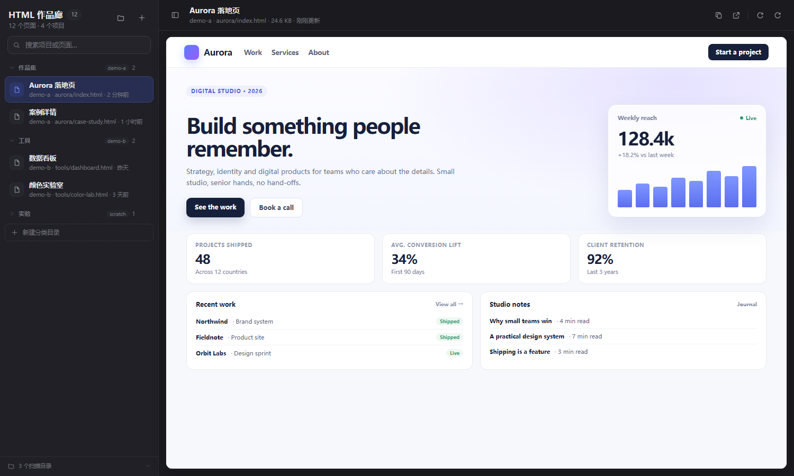
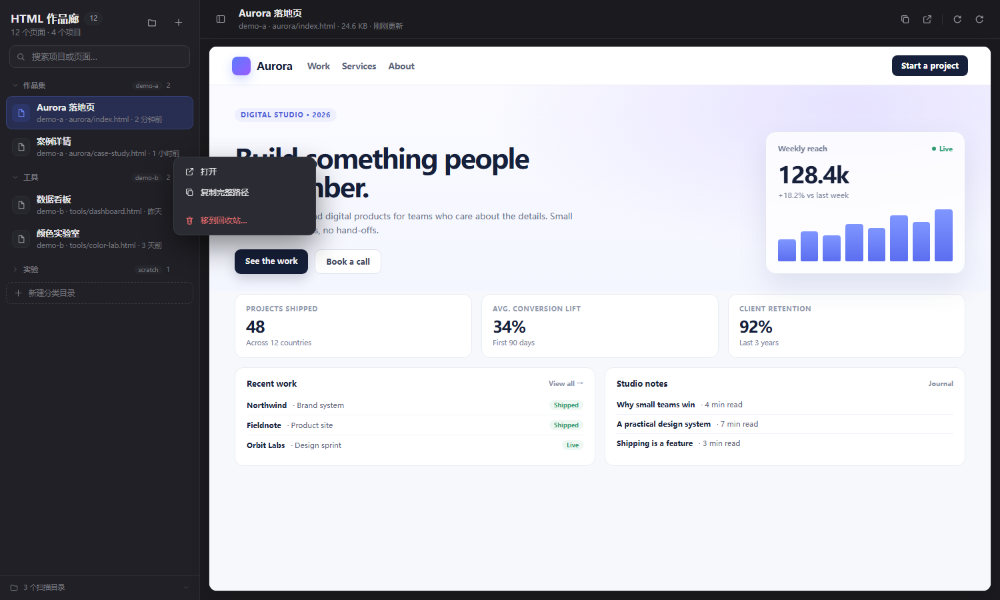
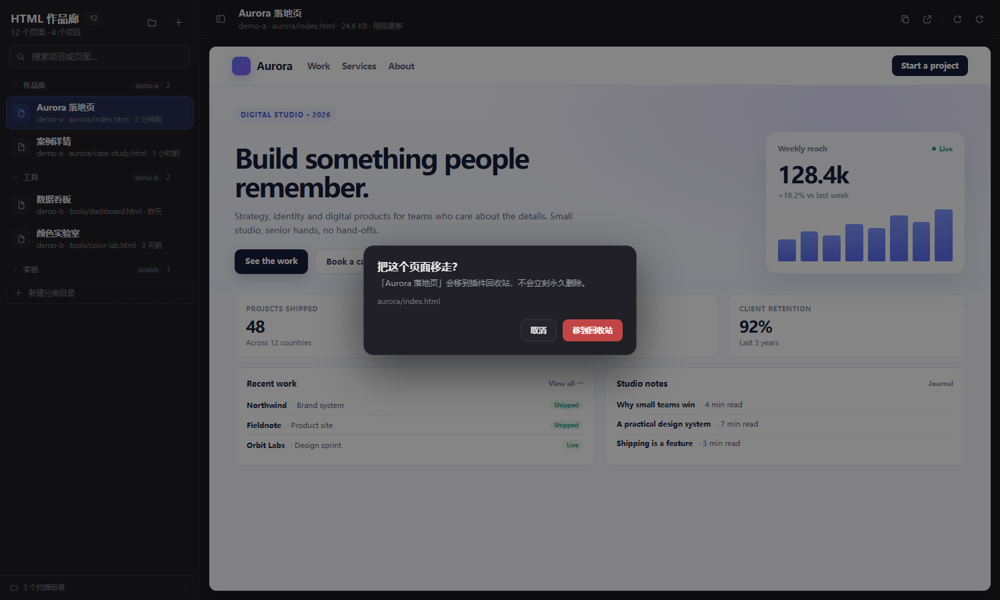
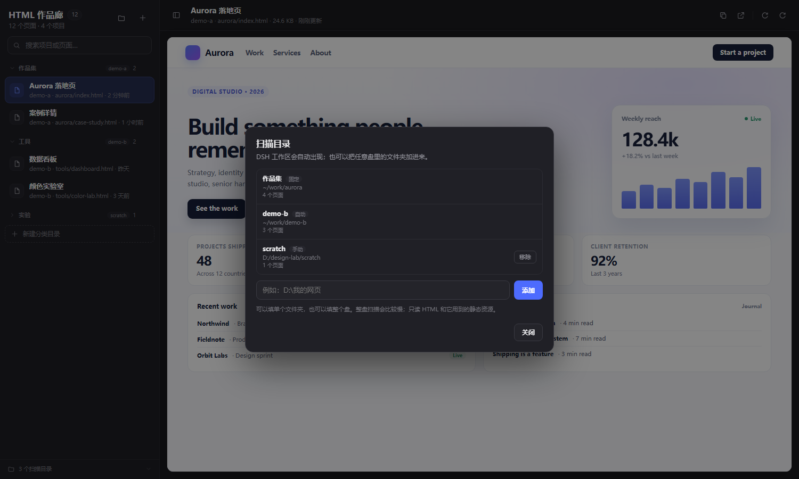
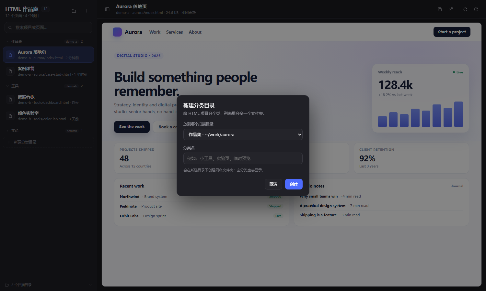

# HTML Gallery · DSH Plugin

**English** | [简体中文](README.md)

A DSH plugin that collects HTML pages from your DSH workspaces and other folders into one searchable, categorized panel — and opens them right inside the DSH interface.



> Screenshots use fictional demo data. No real workspace files, paths, or account information are shown.

## Features

- **Follows DSH workspaces automatically** — reads `$DSH_HOME/storages/workspace.json`; HTML pages in any registered workspace show up without manual setup.
- **Extra scan roots** — add any folder, drive, or project directory from the “Scan folders” dialog. Whole-drive scans work but are slower.
- **Automatic categories** — pages are grouped by their first-level folder; root-level files go to “Root”. The source workspace is shown as a small badge.
- **Collapsible sidebar** — hide the project sidebar to give the HTML page the full panel. The state is remembered.
- **Same-origin iframe preview** — relative CSS, JS, images, and fonts load normally.
- **Search and collapse** — filter by title, filename, relative path, or project; collapse categories.
- **Create / rename categories** — categories are real folders on disk; empty categories are kept in a registry.
- **Right-click to trash** — move a single HTML file or a whole category to the plugin trash folder instead of deleting it permanently.
- **Local-only file server** — loopback only, path-traversal safe, scoped to scan roots, and limited to a whitelist of static file types.

| Context menu | Delete confirmation |
| --- | --- |
|  |  |

| Scan folders | New category |
| --- | --- |
|  |  |

## Requirements

- DSH Web GUI (desktop or web) with the Cordis plugin system.
- Tested with DSH `2.0.22-next`, dsh `0.2.2-rc.1`, Windows 11.
- The host half uses Node built-ins only; there are no third-party runtime dependencies.

DSH evolves quickly, so installation fields may change between versions. The steps below match the tested release.

## Installation

### Option A — let DSH install it (recommended)

Clone the repository:

```bash
git clone https://github.com/XZX888/dsh-html-gallery.git
```

Then ask the DSH assistant:

```text
Use plugin_manager install_bundle to install the local bundle at <absolute path to this repository> into the current DSH profile.
```

Refresh or restart DSH Web. An “HTML 作品廊” (HTML Gallery) entry appears in the left sidebar.

### Option B — link it into the profile manually

Back up the profile’s `package.json` first, then:

1. Add a local link under `dependencies` (use forward slashes on Windows):
   ```json
   "@local/dsh-html-gallery": "link:D:/tools/dsh-html-gallery"
   ```
2. Add `"@local/dsh-html-gallery"` to `dsh.profile.bundles`.
3. Run `pnpm install` in the profile directory and refresh DSH.

Profile fields differ slightly between DSH versions; use Option A if unsure.

## Usage

1. Click **HTML 作品廊** (HTML Gallery) in the left sidebar.
2. DSH workspaces are scanned automatically. To add another folder, click the folder icon in the panel header, enter a path, and press “Add”.
3. Click a category to collapse or expand it; click a page to open it on the right.
4. Use the panel’s top-left button to hide the project sidebar.
5. Right-click a page: open, copy full path, or move to trash.
6. Right-click a category: rename the category folder or delete the whole category.
7. Click the circular-arrow button to rescan after adding or removing files.

Creating a category creates a real folder under the selected scan root. Put HTML files inside and they appear under that category. Empty categories are recorded in `<scan-root>/.dsh-html-gallery/categories.json`.

Deleted items are moved to `<scan-root>/.dsh-html-gallery/trash/`. Delete that folder manually when you want to reclaim the space.

The current UI labels are in Chinese; the behavior is described in this English guide.

## Configuration

You can pin extra scan roots or add excluded folders in `cordis.patch.yml`:

```yaml
- insert:
    - id: html-gallery
      name: '@local/dsh-html-gallery'
      config:
        roots:
          - 'D:/projects/pages'
        excludeDirs:
          - 'private-demo'
```

- Leave `roots` empty to follow DSH workspaces only.
- Workspace changes are picked up on the next refresh.
- Manually added roots are stored in `$DSH_HOME/html-gallery/roots.json`.
- Default exclusions include `node_modules`, `.git`, `.dsh-tmp`, `.tools`, `windows`, `program files`, `appdata`, `.ssh`, and similar folders.
- Limits: 2000 HTML files total, 500 per root, depth 9; results are truncated and marked in the scan dialog when exceeded.

## Privacy and security

- Scanning, indexing, and file serving stay on your machine. Nothing is uploaded or reported.
- File routes accept loopback requests only; paths must stay inside a scan root; dotfiles and unknown extensions are rejected.
- HTML runs in an iframe on the same origin as the DSH Web UI. **Only open HTML you trust.** Pages can make their own external requests (CDNs, fonts, analytics); the plugin does not block them.
- “Delete” means “move to the plugin trash”, not permanent deletion. Trash files still use disk space until you clean them up.

## Known limitations

- Hard-coded `file:///...` image paths inside an HTML page are blocked by Chromium. Use relative paths or keep assets next to the HTML file.
- Scanning a whole drive is slow; prefer adding specific project folders.
- UI strings are currently Chinese only.

## Development

```bash
npm run check
npm test
```

- `npm run check` runs syntax checks for the host and client halves.
- `npm test` runs category/trash/extra-root tests plus workspace auto-discovery tests. Tests use the system temp directory and do not touch real workspaces.

Layout:

```text
lib/index.js       host: scanning, HTTP routes, category registry, trash
lib/client.js      client: sidebar entry, panel, context menu, dialogs
cordis.patch.yml   bundle declaration
locale/            English/Chinese plugin metadata
docs/              README screenshots (demo data)
tests/             Node tests
```

## License

[MIT](LICENSE)
