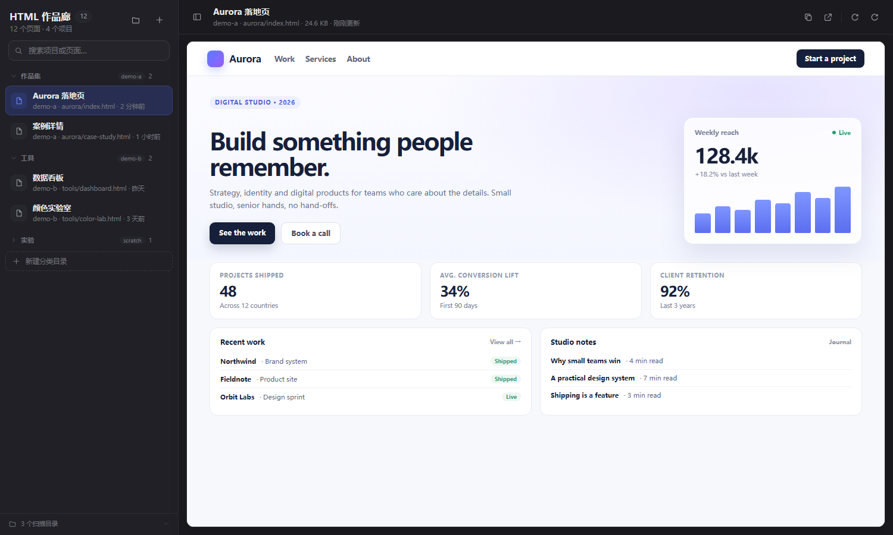
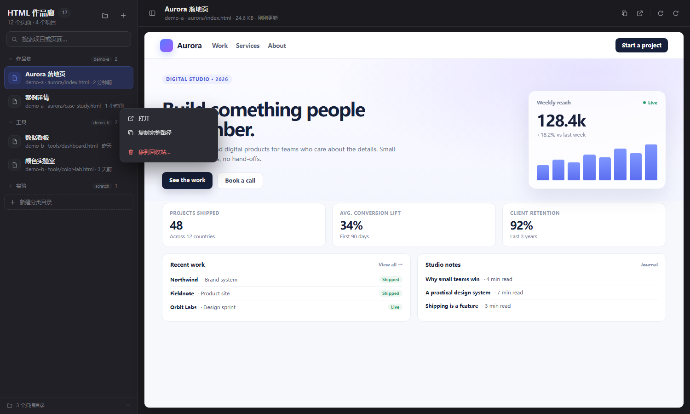
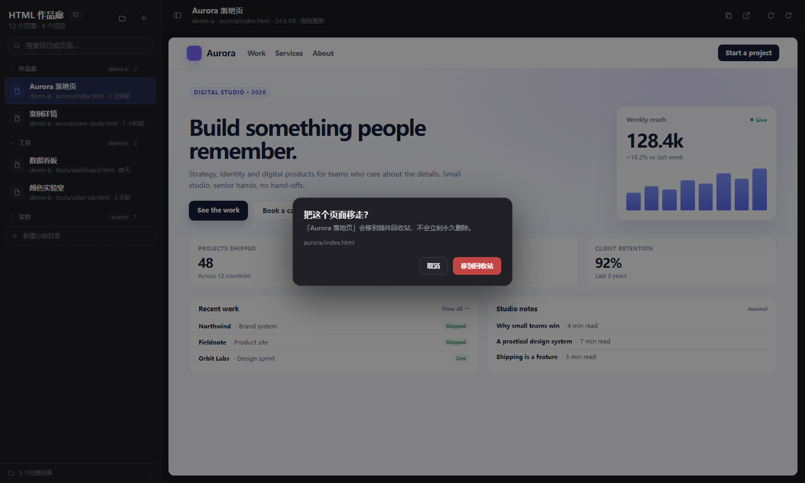
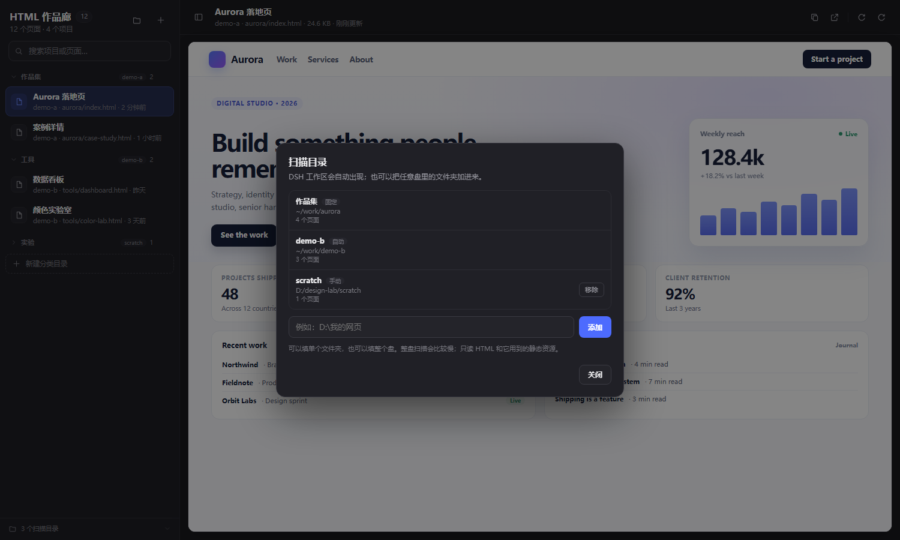
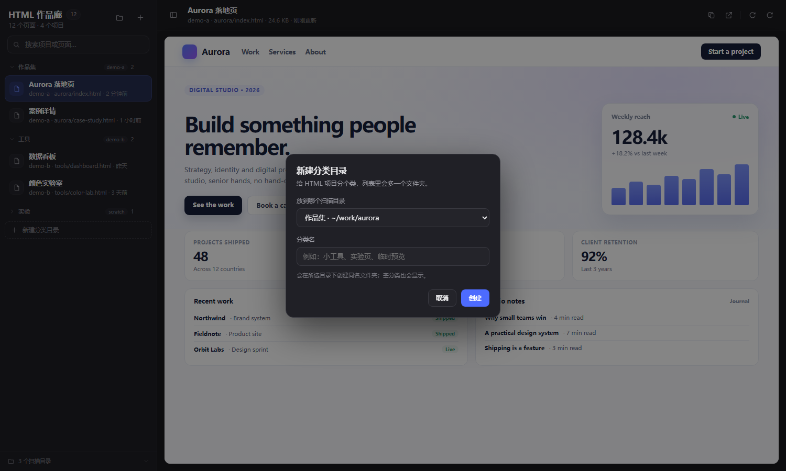

# HTML 作品廊 · DSH 插件

[English](README.en.md) | **简体中文**

把散落在 DSH 工作区、其他盘符和任意文件夹里的 HTML 页面，收进一个可搜索、可分类、可收起侧栏的面板里，直接在 DSH 界面中打开。



> 截图使用虚构的演示数据，不含任何真实工作文件、路径或账号信息。

## 功能

- **自动跟随 DSH 工作区**：读取 `$DSH_HOME/storages/workspace.json`，新工作区里的 HTML 会自动出现，不用手动添加。
- **额外扫描目录**：不在 DSH 工作区里的文件夹，可以在「扫描目录」里手动加入；支持整个盘符（扫描会慢一些）。
- **按项目分类**：按 HTML 所在的一级文件夹自动分组，根目录文件归到「根目录」；分类名旁显示来自哪个扫描目录。
- **可收起侧栏**：面板左上角的按钮可以收起项目侧栏，让 HTML 占满整个面板；状态会记住。
- **同源 iframe 打开**：页面里的相对 CSS、JS、图片、字体都能正常加载。
- **搜索与折叠**：按标题、文件名、相对路径、项目名过滤；分类可折叠。
- **新建 / 重命名分类**：分类就是磁盘上的真实文件夹；空分类也会保留在列表里。
- **右键删除到回收站**：单个 HTML 或整个分类都可以右键移入插件回收站，不会立刻永久删除。
- **本机只读服务**：文件路由只监听本机、限制在扫描根内、防目录穿越、只提供白名单静态文件类型。

| 右键菜单 | 删除确认 |
| --- | --- |
|  |  |

| 扫描目录 | 新建分类 |
| --- | --- |
|  |  |

## 环境

- DSH Web GUI（桌面版或 Web 版）与 Cordis 插件系统。
- 开发时验证版本：DSH `2.0.22-next`、dsh `0.2.2-rc.1`、Windows 11。
- 宿主端只用 Node 内置模块，没有第三方运行时依赖。

DSH 还在快速迭代，插件字段和安装方式可能随版本变化；下面是当前版本的用法。

## 安装

### 方式 A：让 DSH 安装（推荐）

把仓库克隆到本地任意目录，例如：

```bash
git clone https://github.com/XZX888/dsh-html-gallery.git
```

然后在 DSH 里对助手说：

```text
请用 plugin_manager 的 install_bundle，把本地目录 <仓库的绝对路径> 安装到当前 DSH profile。
```

安装完成后刷新 / 重启 DSH Web，左侧栏会出现「HTML 作品廊」。

### 方式 B：手动挂到 profile

先备份 profile 的 `package.json`，然后：

1. 在 `dependencies` 里加入本地链接（Windows 路径用正斜杠）：
   ```json
   "@local/dsh-html-gallery": "link:D:/tools/dsh-html-gallery"
   ```
2. 在 `dsh.profile.bundles` 里加入 `"@local/dsh-html-gallery"`。
3. 在 profile 目录执行 `pnpm install`，刷新 DSH。

不同 DSH 版本的 profile 字段可能略有差异；不确定就用方式 A。

## 使用

1. 点左侧栏的 **HTML 作品廊**。
2. 默认会自动扫描所有 DSH 工作区。要加别的目录，点面板右上角的文件夹按钮，输入路径后点「添加」。
3. 点分类名折叠 / 展开；点页面在右侧打开。
4. 面板左上角的按钮收起项目侧栏。
5. 右键页面：打开、复制完整路径、移到回收站。
6. 右键分类：重命名分类目录、删除整个分类。
7. 顶部圆形箭头重新扫描；新增或删除文件后点一下即可。

新建分类会在所选扫描目录下创建真实文件夹，把 HTML 放进去就会出现在该分类里。空分类会登记在 `<扫描根>/.dsh-html-gallery/categories.json`，所以不会因为暂时没有文件而消失。

删除的项目会移动到 `<扫描根>/.dsh-html-gallery/trash/`，需要彻底清理时手动删除这个目录即可。

## 配置

`cordis.patch.yml` 里可以固定额外的扫描根，或追加排除目录：

```yaml
- insert:
    - id: html-gallery
      name: '@local/dsh-html-gallery'
      config:
        roots:
          - 'D:/projects/pages'
        excludeDirs:
          - 'private-demo'
```

- `roots` 留空时只跟随 DSH 工作区。
- 工作区列表变化会在下一次刷新时重新读取。
- 手动添加的目录保存在 `$DSH_HOME/html-gallery/roots.json`。
- 默认排除 `node_modules`、`.git`、`.dsh-tmp`、`.tools`、`windows`、`program files`、`appdata`、`.ssh` 等目录。
- 扫描上限：全局 2000 个 HTML、每个扫描根 500 个、深度 9 层；超出会截断并在扫描目录里标记。

## 隐私与安全

- 扫描、索引、文件服务都在本机完成，不上传文件、不联网上报。
- 文件路由只接受 loopback 请求，路径必须落在扫描根内；未知扩展名和点文件会被拒绝。
- HTML 在 iframe 里以与 DSH Web 相同的源运行。**只打开你信任的 HTML**；页面本身可以发起外部请求（CDN、字体、统计脚本等），插件不会拦截。
- 删除是「移到回收站」，不是永久删除；但回收站里的文件仍占磁盘，记得定期清理。

## 已知限制

- 页面里写死的 `file:///...` 绝对路径图片会被 Chromium 拦截；请使用相对路径，或把资源放到 HTML 同级目录。
- 扫描整个盘符会慢，建议只添加具体项目目录。
- 目前界面文案为中文；英文说明见 [README.en.md](README.en.md)。

## 开发与测试

```bash
npm run check
npm test
```

- `npm run check`：对宿主端和客户端做语法检查。
- `npm test`：跑分类 / 回收站 / 额外目录测试，以及工作区自动发现测试。测试使用系统临时目录，不会碰真实工作区。

目录结构：

```text
lib/index.js       宿主端：扫描、HTTP 路由、分类登记、回收站
lib/client.js      客户端：侧栏入口、面板、右键菜单、对话框
cordis.patch.yml   bundle 声明
locale/            中英文插件元数据
docs/              README 截图（演示数据）
tests/             Node 测试
```

## License

[MIT](LICENSE)
